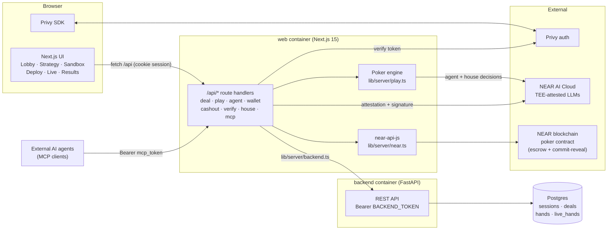
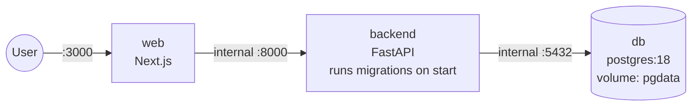
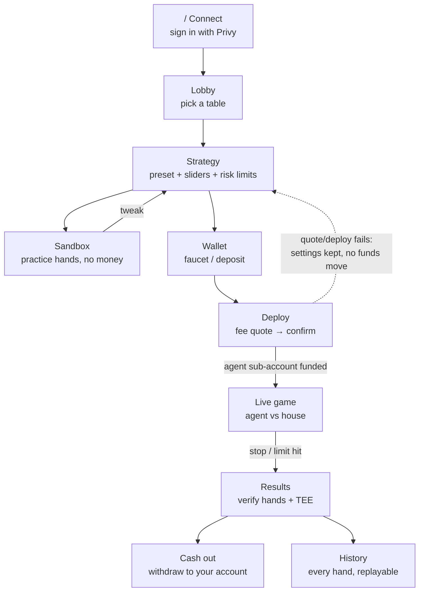
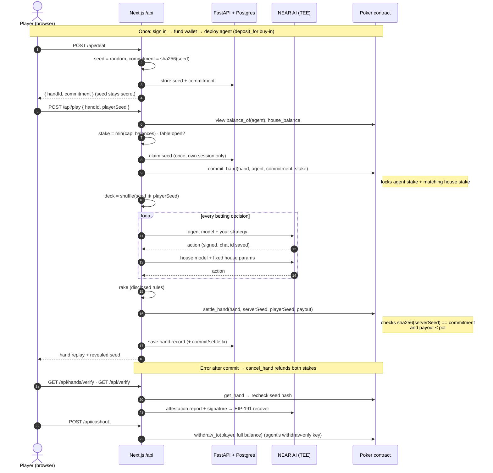
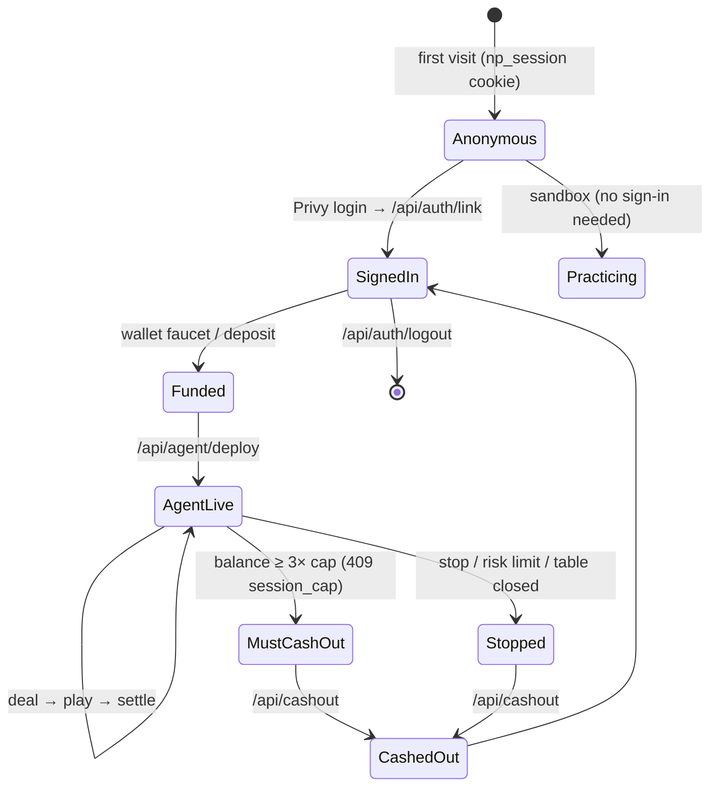

# 🦬 Bluffalo

> **Your strategy. Your AI agent. Provably fair poker.**
> Design a poker personality, practice it for free, then send your AI agent to play heads-up Texas Hold'em against an AI house for real NEAR. Every deal is cryptographically committed on-chain before the cards come out, and every agent decision is signed by a model running inside a hardware TEE.

---

## Table of contents

1. [What it does](#what-it-does)
2. [Deploy in 5 minutes (no coding needed)](#deploy-in-5-minutes-no-coding-needed)
3. [Getting your keys](#getting-your-keys)
4. [Architecture](#architecture)
5. [User journey](#user-journey)
6. [How one hand works](#how-one-hand-works-sequence)
7. [Why it is fair](#why-it-is-fair)
8. [House economics](#house-economics-disclosed)
9. [Smart contract](#smart-contract)
10. [Local development](#local-development)
11. [Troubleshooting](#troubleshooting)
12. [Contributing](#contributing)

---

## What it does

| Step | You do | You see |
|---|---|---|
| 1. Connect | Sign in with email or a wallet | The lobby. No seed phrase |
| 2. Strategy | Pick a preset, tune aggression, bluffing, position play and bet sizing | Sliders and safety limits (stop loss, take profit, max hands) |
| 3. Practice | Run your agent at the practice table | A "Practice · simulated" badge, plus win rate, P&L and a decision feed |
| 4. Fund | Open Wallet and top up from the testnet faucet | Your deposit address and balance |
| 5. Deploy | Review the fee quote, then confirm | Your agent gets its own NEAR sub-account holding its buy-in |
| 6. Watch | Open Live | Animated hands with each decision your agent makes |
| 7. Verify | Open Results | A commit-reveal check for every hand and a live TEE attestation check |
| 8. Cash out | Withdraw | The agent's whole on-chain balance goes back to you |

---

## Deploy in 5 minutes (no coding needed)

You need **one program**: [Docker Desktop](https://www.docker.com/products/docker-desktop/). Install it, open it, and wait until it says *running*.

Then open a terminal (macOS: **Terminal**, Windows: **PowerShell**) and paste these lines one at a time:

```bash
# 1. Download the project
git clone https://github.com/Neeraj1850/near-poker-agent.git bluffalo
cd bluffalo

# 2. Create your settings file
cp .env.deploy.example .env.deploy
```

Open `.env.deploy` in any text editor and fill it in. [Getting your keys](#getting-your-keys) says where each value comes from. You need at least these two:

```bash
POSTGRES_PASSWORD=any-long-password-you-make-up
BACKEND_TOKEN=paste-a-random-string-here   # make one with: openssl rand -hex 32
```

```bash
# 3. Start everything (the first run takes a few minutes)
docker compose --env-file .env.deploy up --build -d
```

**4. Open http://localhost:3000** 🎉

That's all. The database, backend and web app start together, and database migrations run automatically.

| Want to… | Run |
|---|---|
| See logs | `docker compose --env-file .env.deploy logs -f` |
| Stop it | `docker compose --env-file .env.deploy down` |
| Update to the latest code | `git pull && docker compose --env-file .env.deploy up --build -d` |
| Wipe all data (⚠️ irreversible) | `docker compose --env-file .env.deploy down -v` |

> **Putting it on a real server?** Run the same commands on any VPS with Docker installed, and put HTTPS in front of port 3000 (for example Caddy or Cloudflare Tunnel). The session cookie is `Secure` in production, so plain HTTP sign-in will not work there. Also add your domain to Privy's allowed domains.

---

## Getting your keys

All of these go in `.env.deploy`. The app starts with only the two required values, and each optional one switches on a feature.

| Variable | Required? | What it unlocks | Where to get it |
|---|---|---|---|
| `POSTGRES_PASSWORD` | ✅ yes | Database | Make one up |
| `BACKEND_TOKEN` | ✅ yes | Lets the web app talk to the backend | `openssl rand -hex 32` |
| `NEAR_AI_API_KEY` | for play | AI agent and house decisions (in a TEE) | [cloud.near.ai](https://cloud.near.ai) → API keys |
| `NEXT_PUBLIC_PRIVY_APP_ID` | for sign-in | Email and wallet login | [dashboard.privy.io](https://dashboard.privy.io) → create an app |
| `PRIVY_APP_SECRET` | for sign-in | Server-side token check | Same Privy app → Settings |
| `NEAR_OPERATOR_KEY` | for real money | On-chain commit/settle and funding agents | `private_key` in `~/.near-credentials/testnet/<operator>.json` (see [Smart contract](#smart-contract)) |
| `NEAR_CONTRACT_ID` | optional | Your own deployed contract | Default `npk-63o824.testnet` |
| `NEAR_OPERATOR_ID` | optional | Your operator account | Default `npoker-op-43b602.testnet` |
| `NEAR_RPC_URL` | optional | RPC endpoint | Default `https://test.rpc.fastnear.com` |
| `NEAR_AI_AGENT_MODEL` / `NEAR_AI_HOUSE_MODEL` | optional | Choose the models | e.g. `Qwen/Qwen3.6-35B-A3B-FP8`, `z-ai/glm-5.3-flash` |

**Privy setup checklist:**
1. Turn on the **Email** and **Wallet** login methods.
2. Under *Configuration → App settings → Domains*, add `http://localhost:3000` and your production URL.
3. After changing `NEXT_PUBLIC_PRIVY_APP_ID`, re-run with `--build`. The value is baked into the build.

> If NEAR AI is unreachable (no key, rate limit, outage), the hand stops with a clear *"agent service is down"* message. The app never quietly swaps in another strategy.

---

## Architecture



| Layer | Tech | Job |
|---|---|---|
| Frontend | Next.js 15, Tailwind v4, Framer Motion 12 | Monochrome UI with spring animations, light and dark mode, mobile first |
| Server routes | Next.js route handlers | Game engine, NEAR AI calls, chain transactions. All secrets stay here |
| Storage | FastAPI, SQLAlchemy 2, Alembic, Postgres | Sessions, deal seeds (handed out once), hand history |
| AI | NEAR AI Cloud | Agent and house decisions in a TEE, each response signed |
| Chain | Rust contract (near-sdk 5) | Escrow, hand commitments, payouts |
| Auth | Privy | Email or wallet sign-in. Real money requires sign-in |

**Containers** (`docker-compose.yml`). Only `web` is exposed:



```
frontend/   Next.js app: src/app (pages + /api), components, lib/server (engine, chain, AI)
backend/    FastAPI storage service + Alembic migrations
contracts/  poker/: Rust NEAR contract + deploy.sh
```

---

## User journey



---

## How one hand works (sequence)



**Session lifecycle:**



---

## Why it is fair

- **Commit-reveal deal.** Before any card is dealt, `sha256(server seed)` is written to the contract. Your browser adds its own random seed, so neither side controls the shuffle alone. At settlement the contract refuses any seed that doesn't match the commitment. Anyone can read both seeds with `get_hand`, re-shuffle, and check the hand.
- **TEE-signed decisions.** Agent and house moves come from NEAR AI Cloud models running in Intel TDX / NVIDIA confidential compute. `GET /api/verify` checks that the response signature recovers (EIP-191) to a signer the model's hardware attestation vouches for. The full quote can be checked at [cloud.near.ai/verify](https://cloud.near.ai/verify).
- **The house never sees your cards.** The house model only gets public information (equity, pot odds, stack-to-pot ratio) and fixed, published parameters.
- **Bounded keys.** Each agent sub-account's key can only withdraw to you. Payouts can never exceed the pot.

---

## House economics (disclosed)

The house earns only from the fees below. It never touches the shuffle. Every value can be overridden with an env var.

| What | Default (env) |
|---|---|
| Rake when the agent **wins** a pot after the flop (no flop, no drop; never more than the agent won) | 5% (`RAKE_PCT`), cap 3 BB (`RAKE_CAP_BB`) |
| Table fee at deploy, sent to the operator treasury | 2% of buy-in (`TABLE_FEE_PCT`) |
| Max buy-in and house stake per hand, as a share of the *current* house balance | 1% (`MAX_EXPOSURE_PCT`) |
| Table closes (`503 table_closed`) when that cap falls below the table minimum | follows the cap |
| Agent must cash out at N × the current cap (`409 session_cap`) | 3 (`MAX_SESSION_PAYOUT_MULT`) |
| House bankroll kept by `POST /api/house/sweep`; the excess goes to the operator | 5 NEAR (`HOUSE_TARGET`) |

Testnet amounts are table amounts ÷ 1000, so a 50 NEAR buy-in costs 0.05 test NEAR.

---

## Smart contract

`contracts/poker` (Rust, near-sdk 5) holds the money and makes every hand auditable. Game logic and AI stay off-chain.

| Method | Who | Does |
|---|---|---|
| `new(operator)` | deployer | Initialise |
| `deposit()` / `deposit_for(account)` | anyone (payable) | Fund a player balance |
| `withdraw(amount)` / `withdraw_to(receiver, amount)` | balance owner | Take money out |
| `fund_house()` / `withdraw_house(amount)` | anyone / operator | Manage the house bankroll |
| `commit_hand(hand, player, commitment, stake)` | operator | Lock both stakes, store the commitment |
| `settle_hand(hand, server_seed, player_seed, payout)` | operator | Verify the seed, pay out (≤ pot) |
| `cancel_hand(hand)` | operator | Refund both stakes |
| `balance_of`, `house_balance`, `get_hand`, `operator` | anyone (view) | Read state |

**Deploy your own** (optional; the default testnet contract works out of the box):

```bash
# prerequisites: Rust (rustup), cargo-near, near CLI (near-cli-rs)
cargo install cargo-near near-cli-rs

# create two funded testnet accounts (contract + operator)
near account create-account sponsor-by-faucet-service my-poker.testnet autogenerate-new-keypair save-to-legacy-keychain network-config testnet create
near account create-account sponsor-by-faucet-service my-poker-op.testnet autogenerate-new-keypair save-to-legacy-keychain network-config testnet create

cd contracts/poker
cargo test                                                     # unit tests
CONTRACT=my-poker.testnet OPERATOR=my-poker-op.testnet ./deploy.sh init   # first deploy
./deploy.sh                                                    # later: redeploy, keeps state
```

Then set `NEAR_CONTRACT_ID`, `NEAR_OPERATOR_ID` and `NEAR_OPERATOR_KEY` (from `~/.near-credentials/testnet/my-poker-op.testnet.json`) in `.env.deploy`, and fund the house with `fund_house`.

---

## Local development

Requires Node 20+, Python 3.13 with [uv](https://docs.astral.sh/uv/), and Postgres.

```bash
# Terminal 1: backend on :8000
cd backend
cp .env.example .env               # DATABASE_URL, BACKEND_TOKEN
createdb near_poker
uv sync
uv run alembic upgrade head
uv run uvicorn app.main:app --reload --port 8000

# Terminal 2: web on :3000
cd frontend
cp .env.example .env.local         # same BACKEND_TOKEN + keys above
npm install
npm run dev
```

`BACKEND_TOKEN` must be the same in both files.

---

## Troubleshooting

| Symptom | Fix |
|---|---|
| `required variable POSTGRES_PASSWORD is missing` | You forgot `--env-file .env.deploy`, or the value is empty |
| "Agent service is down" | `NEAR_AI_API_KEY` is missing or invalid, or NEAR AI is rate-limiting you |
| Sign-in button disabled or failing | Set the Privy ID and secret, add your domain in Privy, rebuild with `--build` |
| Real-money table shows *closed* | The house balance is too low. Fund it with `fund_house` |
| Deploy works but nothing happens on-chain | `NEAR_OPERATOR_KEY` is not set |
| Port 3000 is busy | Change `"3000:3000"` in `docker-compose.yml` to e.g. `"8080:3000"` |

---

## Contributing

- Every feature and bug fix ships with a test: `frontend/src/tests/` (vitest) or `backend/tests/` (pytest).
- `make check` (ESLint, ruff, tsc, vitest, pytest) must pass. Enable the pre-commit hook once with `git config core.hooksPath .githooks`.
- Branches: `main` holds releases, `dev` is for integration. Feature branches are named `<issue>-<short-name>` and merge into `dev`.
- Conventional commits: `feat:`, `fix:`, `docs:`, `chore:` …

**Roadmap:** cross-chain buy-in and cash-out via NEAR Intents (mainnet only, not wired yet).

## License

MIT
