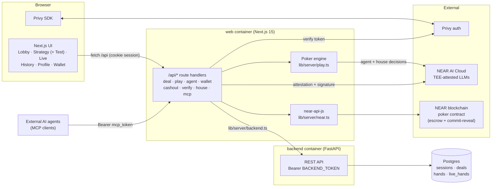
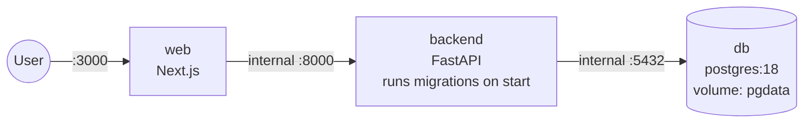
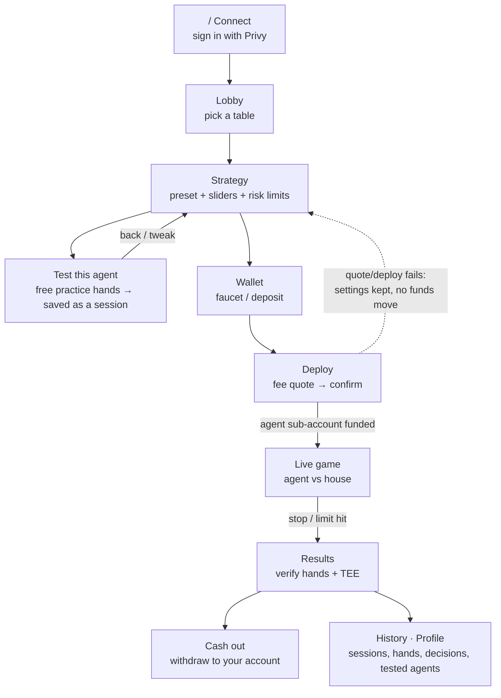
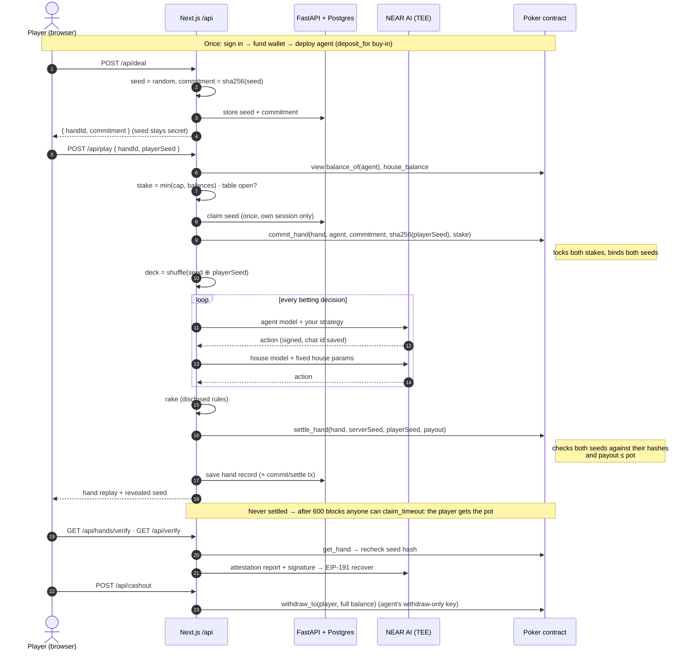
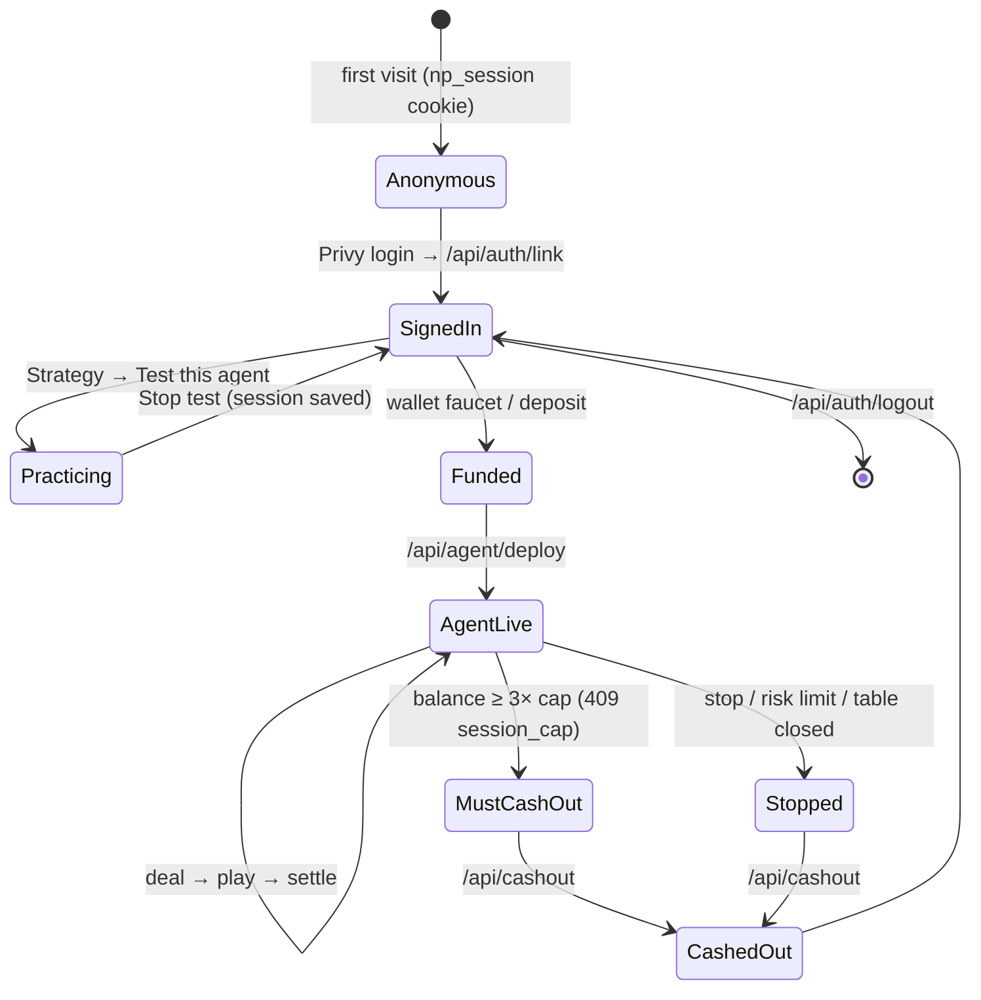

# Bluffalo

> **Your strategy. Your AI agent. Provably fair poker.**
> Design a poker personality, practice it for free, then send your AI agent to play heads-up Texas Hold'em against an AI house for real NEAR testnet stakes. Every deal is cryptographically committed on-chain before the cards come out, and every agent decision is signed by a model running inside a hardware TEE.
> Then sell it: publish your strategy to the **Strategy Market**, where license seats are NEP-245 tokens, prices follow each strategy's verified on-chain record, and three NPC traders with their own wallets buy, sell and reprice.

**Live app:** https://bluffalo.up.railway.app · **Network:** NEAR testnet · **Contract:** [`bluffalo-poker-mwd58e1p.testnet`](https://testnet.nearblocks.io/address/bluffalo-poker-mwd58e1p.testnet) (no access keys: its code can't be changed)

---

## For judges: try it in 3 minutes

No setup, no crypto wallet. Every step below works on the live app.

| # | Do | You should see |
|---|---|---|
| 1 | Open https://bluffalo.up.railway.app and click **Continue with Email**. Enter any email and the 6-digit code Privy sends you | The **Lobby** with four tables |
| 2 | Open **Strategy**, pick **Shark** (or move a slider), then click **Test this agent** | A full-page practice table. Free hands start on their own; each move shows *why* the agent made it |
| 3 | After 2–3 hands click **Stop test**, then **See this test session** | The session: result, hands, and every decision of every hand |
| 4 | Open **Wallet** and click **Fund my wallet with testnet NEAR** | 100 GNEAR arrives in a few seconds (1 testnet NEAR = 1000 GNEAR) |
| 5 | Back on **Strategy** click **Start playing**, tick **I understand…**, then **Put my agent in play** | Your agent gets its own NEAR account holding a 50 GNEAR buy-in |
| 6 | Click **Watch your agent play** | Live hands against the house AI. While playing, the only control is **Stop agent after this hand** |
| 7 | Click **Stop agent after this hand**, then **See the result** | **Fair-play verified** (both seeds matched their on-chain commitments) and **TEE attested · N/N decisions** (every AI decision in that hand was signed inside a TEE) |
| 8 | Open **History** → **Sessions**, or **Profile** → an agent | Every practice and live session, every hand, every decision. Real hands link to their NearBlocks transactions |
| 9 | **Wallet** → **Withdraw** to any testnet account | Funds leave the app; a public transaction link appears |

**The Strategy Market (Games track: player-owned market, NPCs with wallets, evolving prices, fast-forward)**

| # | Do | You should see |
|---|---|---|
| 10 | Open **Market** | Strategies with price, sparkline and verified record (dashed = Unrated, solid = Rated at 100 verified hands). The **Now** feed shows NPC trades with their reasons, and each NPC's wallet balance |
| 11 | Click **Watch a week in 60 s** | `/market/sim`: a seeded week of the market fast-forwarded: prices move, brokers buy and sell, a broker can go broke and close. Labelled *Simulation: practice bots, nothing on-chain*. 10×/100×/Skip to end |
| 12 | Open any strategy and click **Why?** next to its price | Every input of the price (verified ROI and hands, seats listed, recent demand) and a link to the one rules file, [`frontend/src/lib/market/rules.ts`](frontend/src/lib/market/rules.ts) |
| 13 | In the **Now** feed, open a **Scout** line | Scout is an AI trader: its reasoning comes from NEAR AI and its chat id verifies as TEE-signed (`/api/verify?chats=<id>`) |
| 14 | **Buy license** (fund your wallet first if asked) | Quote → Submitted → Confirmed, no wallet popup. The seat is an NEP-245 token in your app account |
| 15 | **Use it as your agent** → **Start playing** | The licensed agent plays with the creator's sealed settings; its hands add to that strategy's verified record |
| 16 | **Strategy** → **Publish to the market** | Your own strategy minted as NEP-245 seats and listed. Settings stay on the server; only a salted hash goes on-chain |

Each real-money hand is two on-chain transactions: `commit_hand` before the deal (both stakes locked, hashes of the server seed **and** the player's seed stored) and `settle_hand` after it (both seeds checked against those hashes, payout ≤ pot). Example on the current contract: [commit_hand](https://testnet.nearblocks.io/txns/7cAjNUJM1v7GPaispkEGLZNxDSF1yjdydKoocRW2hVah).

| On-chain account | Role |
|---|---|
| [`bluffalo-poker-mwd58e1p.testnet`](https://testnet.nearblocks.io/address/bluffalo-poker-mwd58e1p.testnet) | Poker contract v2: escrow, hand commitments, payouts. Deployed then its only full-access key deleted ([tx](https://testnet.nearblocks.io/txns/BVxfwXBgktrqMotQ8kQbJMvxHUKzvpbedXwygRtPkVXh)): zero keys, code can't change. Code hash `EeKs6tbcPiCoQX5MHxK9pU8MctUk3XEN5rRHfdvpRwuc` = base58 of the WASM's sha256 `cab7bfd689a1f5331c4cbbfadd8ad2f6ac0a8a7d3aa929abfe01715b864e4953` |
| [`npoker-op-43b602.testnet`](https://testnet.nearblocks.io/address/npoker-op-43b602.testnet) | Operator: commits and settles hands, creates agent accounts |
| `a<id>.npoker-op-43b602.testnet` | One per deployed agent. Its only key is a function-call key for the contract's `withdraw_to`: it can't send NEAR any other way. The receiver is chosen by our server (your wallet, or the account you type when cashing out) |
| [`npk-63o824.testnet`](https://testnet.nearblocks.io/address/npk-63o824.testnet) | Contract v1 (hands played before the v2 fairness fixes; still verifiable) |
| [`market.npoker-op-43b602.testnet`](https://testnet.nearblocks.io/address/market.npoker-op-43b602.testnet) | Strategy market (`contracts/market`): NEP-245 multi-token (`mt_*`, events standard `nep245`), listings, atomic `buy` with creator royalty, `use_license` (burns a seat and binds an agent). Never holds NEAR beyond storage |
| [`scout`](https://testnet.nearblocks.io/address/scout.npoker-op-43b602.testnet) / [`bookie`](https://testnet.nearblocks.io/address/bookie.npoker-op-43b602.testnet) / [`tilt`](https://testnet.nearblocks.io/address/tilt.npoker-op-43b602.testnet)`.npoker-op-43b602.testnet` | The three NPC traders' wallets. Bookie (value broker, lists the house library) and Tilt (momentum broker) follow `rules.ts`; Scout asks NEAR AI |

**Hackathon notes**

- **Commit history:** the commit timestamps in this repository don't reflect when the code was originally written, so please don't rely on them. The operator and contract accounts' on-chain history on NearBlocks is an independent record of when the app was running.
- **Tracks:** Games (strategy market: NEP-245 seats, player-owned listings, NPC traders with wallets, prices from one rules file, week fast-forward, email login with no popups) and Agents (agents with their own NEAR accounts and withdraw-only keys, agents buying strategies from other players, TEE-signed reasoning for every decision, an MCP server at `/api/mcp` so outside agents can play).
- **AI tools used:** Claude Code (Anthropic) helped write code, tests, docs and the demo video edit; ElevenLabs generated the video narration. In-game AI runs on NEAR AI Cloud (`Qwen/Qwen3.6-35B-A3B-FP8`, TEE-attested).
- **Main libraries:** Next.js 15, React 19, Tailwind CSS 4, Framer Motion 12, Privy (`@privy-io/react-auth`, `@privy-io/node`), `near-api-js`, `ethers` (signature recovery for TEE checks), FastAPI, SQLAlchemy 2, Alembic, `near-sdk` 5 (Rust contract), Vitest, pytest.
- **Tests:** 462 app (vitest) + 55 backend (pytest) + 52 contract (cargo: 34 poker, 18 market) = 569. `make check` runs them all.

---

## Table of contents

1. [For judges](#for-judges-try-it-in-3-minutes)
1. [What it does](#what-it-does)
2. [Deploy in 5 minutes (no coding needed)](#deploy-in-5-minutes-no-coding-needed)
3. [Getting your keys](#getting-your-keys)
4. [Architecture](#architecture)
5. [User journey](#user-journey)
6. [How one hand works](#how-one-hand-works-sequence)
7. [Why it is fair](#why-it-is-fair)
8. [House economics](#house-economics-disclosed)
8. [Strategy market](#strategy-market)
9. [Smart contract](#smart-contract)
10. [Local development](#local-development)
11. [Troubleshooting](#troubleshooting)
12. [Contributing](#contributing)

---

## What it does

| Step | You do | You see |
|---|---|---|
| 1. Connect | Sign in with email or a wallet | The lobby. No seed phrase |
| 2. Strategy | Pick a preset, tune aggression, bluffing, position play and bet sizing | Sliders and safety limits (stop loss, take profit, max hands) |
| 3. Test | **Test this agent** on the Strategy tab: free hands against a practice bot | Win rate, P&L and every decision with its reason. Each test is saved as a session |
| 4. Fund | Open Wallet and tap **Fund my wallet** (in-app faucet, any time you're under 10 GNEAR) | Your deposit address and balance in GNEAR |
| 5. Deploy | Review the fee quote, then confirm | Your agent gets its own NEAR sub-account holding its buy-in |
| 6. Watch | Open Live | Animated hands with each decision your agent makes. One table at a time; Stop is the only control while it plays |
| 7. Verify | Open Results | A commit-reveal check for every hand and a live TEE attestation check |
| 8. Review | History and Profile | Every session (practice and live) with all hands and decisions; each tested agent with its history |
| 9. Cash out | Stop the agent, then Withdraw | The agent's chips return to your balance; withdraw sends them to any testnet account |

---

## Deploy in 5 minutes (no coding needed)

You need **one program**: [Docker Desktop](https://www.docker.com/products/docker-desktop/). Install it, open it, and wait until it says *running*.

Then open a terminal (macOS: **Terminal**, Windows: **PowerShell**) and paste these lines one at a time:

```bash
# 1. Download the project
git clone https://github.com/Neeraj1850/bluffalo-v1.git bluffalo
cd bluffalo

# 2. Create your settings file
cp .env.deploy.example .env.deploy
```

Open `.env.deploy` in any text editor and fill it in. [Getting your keys](#getting-your-keys) says where each value comes from. You need at least these two:

```bash
POSTGRES_PASSWORD=any-long-password-you-make-up
BACKEND_TOKEN=paste-a-random-string-here   # make one with: openssl rand -hex 32
```

```bash
# 3. Start everything (the first run takes a few minutes)
docker compose --env-file .env.deploy up --build -d
```

**4. Open http://localhost:3000**

That's all. The database, backend and web app start together, and database migrations run automatically.

| Want to… | Run |
|---|---|
| See logs | `docker compose --env-file .env.deploy logs -f` |
| Stop it | `docker compose --env-file .env.deploy down` |
| Update to the latest code | `git pull && docker compose --env-file .env.deploy up --build -d` |
| Wipe all data (irreversible) | `docker compose --env-file .env.deploy down -v` |

> **Putting it on a real server?** Run the same commands on any VPS with Docker installed, and put HTTPS in front of port 3000 (for example Caddy or Cloudflare Tunnel). The session cookie is `Secure` in production, so plain HTTP sign-in will not work there. Also add your domain to Privy's allowed domains.

---

## Getting your keys

All of these go in `.env.deploy`. The app starts with only the two required values, and each optional one switches on a feature.

| Variable | Required? | What it unlocks | Where to get it |
|---|---|---|---|
| `POSTGRES_PASSWORD` | yes | Database | Make one up |
| `BACKEND_TOKEN` | yes | Lets the web app talk to the backend | `openssl rand -hex 32` |
| `NEAR_AI_API_KEY` | for play | AI agent and house decisions (in a TEE) | [cloud.near.ai](https://cloud.near.ai) → API keys |
| `NEXT_PUBLIC_PRIVY_APP_ID` | for sign-in | Email and wallet login | [dashboard.privy.io](https://dashboard.privy.io) → create an app |
| `PRIVY_APP_SECRET` | for sign-in | Server-side token check | Same Privy app → Settings |
| `NEAR_OPERATOR_KEY` | for real money | On-chain commit/settle and funding agents | `private_key` in `~/.near-credentials/testnet/<operator>.json` (see [Smart contract](#smart-contract)) |
| `NEAR_CONTRACT_ID` | optional | Your own deployed contract | Default `bluffalo-poker-mwd58e1p.testnet` |
| `NEAR_OPERATOR_ID` | optional | Your operator account | Default `npoker-op-43b602.testnet` |
| `NEAR_RPC_URL` | optional | RPC endpoint | Default `https://test.rpc.fastnear.com` |
| `NEAR_AI_AGENT_MODEL` / `NEAR_AI_HOUSE_MODEL` | optional | Choose the models | Default `Qwen/Qwen3.6-35B-A3B-FP8` (TEE-attested, ~1 s per move with thinking off) |

**Privy setup checklist:**
1. Turn on the **Email** and **Wallet** login methods.
2. Under *Configuration → App settings → Domains*, add `http://localhost:3000` and your production URL.
3. After changing `NEXT_PUBLIC_PRIVY_APP_ID`, re-run with `--build`. The value is baked into the build.

> If NEAR AI is unreachable (no key, rate limit, outage), the hand stops with a clear *"agent service is down"* message. The app never quietly swaps in another strategy.

---

## Architecture



| Layer | Tech | Job |
|---|---|---|
| Frontend | Next.js 15, Tailwind v4, Framer Motion 12 | Monochrome UI with spring animations, light and dark mode, mobile first |
| Server routes | Next.js route handlers | Game engine, NEAR AI calls, chain transactions. All secrets stay here |
| Storage | FastAPI, SQLAlchemy 2, Alembic, Postgres | Sessions, deal seeds (handed out once), hand history |
| AI | NEAR AI Cloud | Agent and house decisions in a TEE, each response signed |
| Chain | Rust contract (near-sdk 5) | Escrow, hand commitments, payouts |
| Auth | Privy | Email or wallet sign-in. Real money requires sign-in |

**Containers** (`docker-compose.yml`). Only `web` is exposed:



```
frontend/   Next.js app: src/app (pages + /api), components, lib/server (engine, chain, AI)
backend/    FastAPI storage service + Alembic migrations
contracts/  poker/: Rust NEAR contract + deploy.sh
```

---

## User journey



---

## How one hand works (sequence)



**Session lifecycle:**



---

## Why it is fair

- **Commit-reveal deal, both seeds bound.** The server commits to its seed before your browser picks yours, and your browser checks the server's commitment. Before any card is dealt, `commit_hand` stores `sha256(server seed)` **and** `sha256(your seed)` on-chain. At settlement the contract refuses any seed that doesn't match its hash, so nobody can swap a seed after the deal. Anyone can read both seeds with `get_hand`, re-shuffle, and check the hand.
- **No voiding losing hands.** There is no operator cancel. A hand left unsettled for 600 blocks (~10 min) can be closed by anyone with `claim_timeout`, and the **player gets the whole pot**, so stalling only costs the house.
- **Immutable contract.** The contract account has no access keys (deleted right after deploy), so its code can't be changed. Download the exact deployed `poker.wasm` from the [contract-v2 release](https://github.com/Neeraj1850/bluffalo/releases/tag/contract-v2) and check it: `shasum -a 256 poker.wasm` must print `cab7bfd6…4953`, the sha256 behind the on-chain code hash. The build isn't reproducible (`non-reproducible-wasm`), so a fresh rebuild may produce a different hash.
- **TEE-signed decisions, checked per hand.** Agent moves come from a NEAR AI Cloud model running in confidential compute. On the Results screen, every AI decision of that hand is checked: its NEAR AI signature must recover (EIP-191) to a signer the model's TEE attestation vouches for (`GET /api/verify?chats=…`). The full hardware quote can be checked at [cloud.near.ai/verify](https://cloud.near.ai/verify).
- **The house never sees your cards.** The house model only gets public information (equity, pot odds, stack-to-pot ratio) and fixed, published parameters.

**Known limits (honest):**
- The contract checks the payout is at most the pot, not that it matches the cards. The cards are checkable by anyone off-chain from the two revealed seeds, but the contract doesn't re-run poker.
- Wallets and agent accounts are custodial on this testnet build: their private keys are stored server-side in Postgres (not encrypted at rest).
- The per-hand TEE check proves each decision was signed by an attested model; it shows the signed request/response hashes rather than re-deriving them from the original bytes.

---

## House economics (disclosed)

The house earns only from the fees below. It never touches the shuffle. Every value can be overridden with an env var.

| What | Default (env) |
|---|---|
| Rake when the agent **wins** a pot after the flop (no flop, no drop; never more than the agent won) | 5% (`RAKE_PCT`), cap 3 BB (`RAKE_CAP_BB`) |
| Table fee at deploy, sent to the operator treasury | 2% of buy-in (`TABLE_FEE_PCT`) |
| Max buy-in and house stake per hand, as a share of the *current* house balance | 1% (`MAX_EXPOSURE_PCT`) |
| Table closes (`503 table_closed`) when that cap falls below the table minimum | follows the cap |
| Agent must cash out at N × the current cap (`409 session_cap`) | 3 (`MAX_SESSION_PAYOUT_MULT`) |
| House bankroll kept by `POST /api/house/sweep`; the excess goes to the operator | 5 NEAR (`HOUSE_TARGET`) |

In-game amounts are **GNEAR** (game NEAR): 1 testnet NEAR = 1000 GNEAR, so a 50 GNEAR buy-in costs 0.05 test NEAR.

Top up the house bankroll from the public testnet faucet with `cd frontend && npm run house:topup` (3 rounds of 10 NEAR by default, max 5; run it only when the house is low).

---

## Strategy market

Play to build a record, publish to sell, trade to profit.

- **Seats are NEP-245 tokens.** Publishing mints 10, 25 or 100 seats of your strategy to your app wallet and lists them. Using a seat (`use_license`) burns it and binds a new agent account to the strategy on-chain (`strategy_of(agent)`), so every hand that agent plays on the poker contract is attributable to the strategy.
- **Settings are sealed.** The params live on the server; on-chain there is only `sha256(params + salt)`. For a licensed agent the server ignores the browser's params, stores `agent: {strategy}` (no params) in hand records, and strips numeric settings from the AI's reasons. Outside MCP agents can't drive a licensed agent. Honest limit: many hands reveal a style, and our server can see the params. A license sells a verified record and convenience, not cryptographic secrecy.
- **Prices come from one file.** [`rules.ts`](frontend/src/lib/market/rules.ts) computes fair value from the verified record (ROI over settled hands, shrunk toward 0 for small samples), seats listed and recent demand, and moves the quote at most ±15% per tick. Listings themselves are set on-chain by sellers and NPCs; the contract enforces them.
- **NPC traders.** Bookie and Tilt are rule-based brokers with their own wallets (a broker under 20 GNEAR closes). Scout asks NEAR AI and shows its signed reasoning, including when it passes; if NEAR AI is down it shows *offline* and does nothing. NPCs act at most every 10 minutes (triggered by page views, ≤5 transactions per tick).
- **Fast-forward** (`/market/sim`) runs in your browser: a seeded week of practice-bot hands and 200 bot traders using the same `rules.ts`. Nothing on-chain, no NEAR AI.
- **Money:** a first sale pays the creator 100%; a resale pays the creator a 10% royalty. Buying is one transaction from your app wallet; the attached deposit caps the price and the excess is refunded. The contract never holds NEAR beyond its storage.
- **Not built:** `mt_transfer_call` (panics `unsupported`), approvals, withdrawing seats to outside wallets.

---

## Smart contract

`contracts/poker` (Rust, near-sdk 5) holds the money and makes every hand auditable. Game logic and AI stay off-chain.

| Method | Who | Does |
|---|---|---|
| `new(operator)` | deployer | Initialise |
| `deposit()` / `deposit_for(account)` | anyone (payable) | Fund a player balance |
| `withdraw(amount)` / `withdraw_to(receiver, amount)` | balance owner | Take money out |
| `fund_house()` / `withdraw_house(amount)` | operator | Manage the house bankroll |
| `commit_hand(hand, player, commitment, player_commitment, stake)` | operator | Lock both stakes, store both seeds' hashes |
| `settle_hand(hand, server_seed, player_seed, payout)` | operator | Verify both seeds against their hashes, pay out (≤ pot) |
| `claim_timeout(hand)` | anyone, after 600 blocks | Close an unsettled hand: the player gets the whole pot |
| `balance_of`, `house_balance`, `get_hand`, `operator` | anyone (view) | Read state |

**Deploy your own** (optional; the default testnet contract works out of the box). `frontend/scripts/deploy-contract.mjs` creates a fresh faucet-funded account, deploys and initialises the contract, then deletes its only full-access key so it can never change:

```bash
cd contracts/poker && cargo near build non-reproducible-wasm
cd ../../frontend && node --env-file=.env.local scripts/deploy-contract.mjs
```

Or with the near CLI and your own accounts:

```bash
# prerequisites: Rust (rustup), cargo-near, near CLI (near-cli-rs)
cargo install cargo-near near-cli-rs

# create two funded testnet accounts (contract + operator)
near account create-account sponsor-by-faucet-service my-poker.testnet autogenerate-new-keypair save-to-legacy-keychain network-config testnet create
near account create-account sponsor-by-faucet-service my-poker-op.testnet autogenerate-new-keypair save-to-legacy-keychain network-config testnet create

cd contracts/poker
cargo test                                                     # unit tests
CONTRACT=my-poker.testnet OPERATOR=my-poker-op.testnet ./deploy.sh init   # first deploy
./deploy.sh                                                    # later: redeploy, keeps state
```

Then set `NEAR_CONTRACT_ID`, `NEAR_OPERATOR_ID` and `NEAR_OPERATOR_KEY` (from `~/.near-credentials/testnet/my-poker-op.testnet.json`) in `.env.deploy`, and fund the house with `fund_house`.

---

## Local development

Requires Node 20+, Python 3.13 with [uv](https://docs.astral.sh/uv/), and Postgres.

```bash
# Terminal 1: backend on :8000
cd backend
cp .env.example .env               # DATABASE_URL, BACKEND_TOKEN
createdb near_poker
uv sync
uv run alembic upgrade head
uv run uvicorn app.main:app --reload --port 8000

# Terminal 2: web on :3000
cd frontend
cp .env.example .env.local         # same BACKEND_TOKEN + keys above
npm install
npm run dev
```

`BACKEND_TOKEN` must be the same in both files.

---

## Troubleshooting

| Symptom | Fix |
|---|---|
| `required variable POSTGRES_PASSWORD is missing` | You forgot `--env-file .env.deploy`, or the value is empty |
| "Agent service is down" | `NEAR_AI_API_KEY` is missing or invalid, or NEAR AI is rate-limiting you |
| Sign-in button disabled or failing | Set the Privy ID and secret, add your domain in Privy, rebuild with `--build` |
| Real-money table shows *closed* | The house balance is too low. Run `npm run house:topup` in `frontend/` |
| "You're already playing at …" | One table at a time: stop the test or the live agent first |
| Deploy works but nothing happens on-chain | `NEAR_OPERATOR_KEY` is not set |
| Port 3000 is busy | Change `"3000:3000"` in `docker-compose.yml` to e.g. `"8080:3000"` |

---

## Contributing

- Every feature and bug fix ships with a test: `frontend/src/tests/` (vitest), `backend/tests/` (pytest) or `contracts/poker/src/tests.rs` (cargo).
- `make check` (ESLint, ruff, tsc, vitest, pytest) must pass. Enable the pre-commit hook once with `git config core.hooksPath .githooks`.
- Conventional commits (`feat:`, `fix:`, `docs:`, `chore:` …). Open a pull request against `main`.

**Roadmap:** cross-chain buy-in and cash-out via NEAR Intents (mainnet only, not wired yet).

## License

[MIT](LICENSE) © 2026 Neeraj1850
